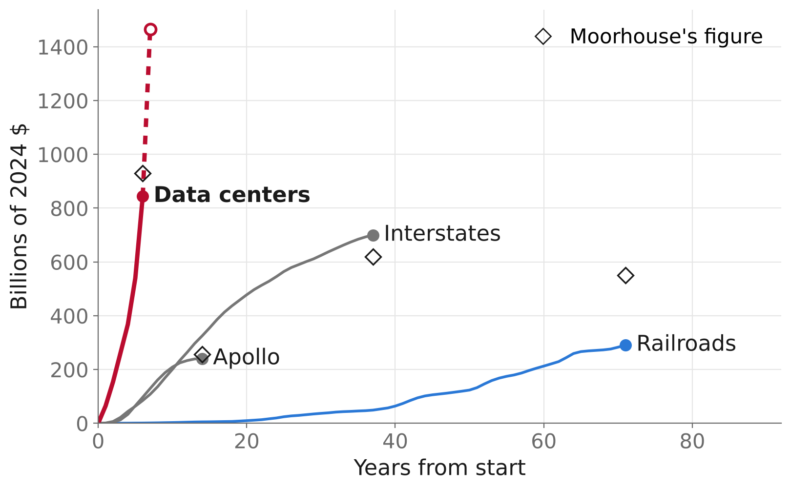
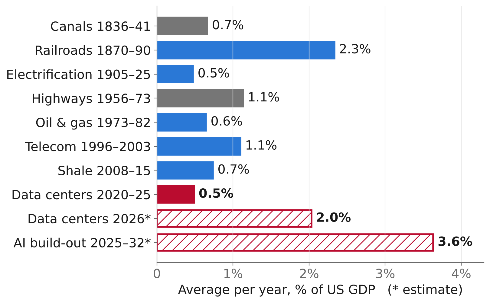
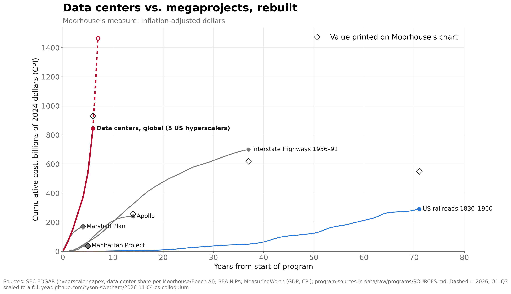
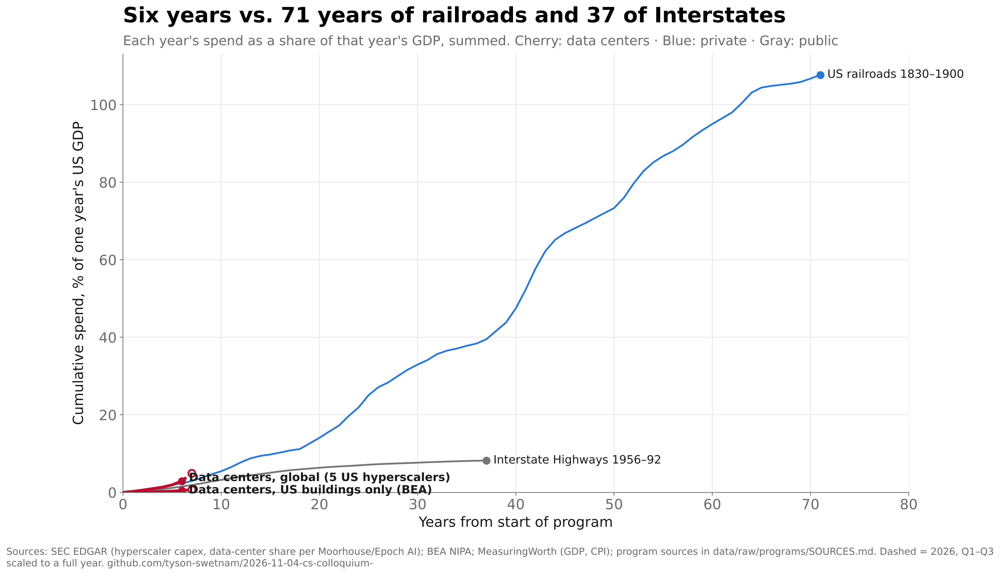
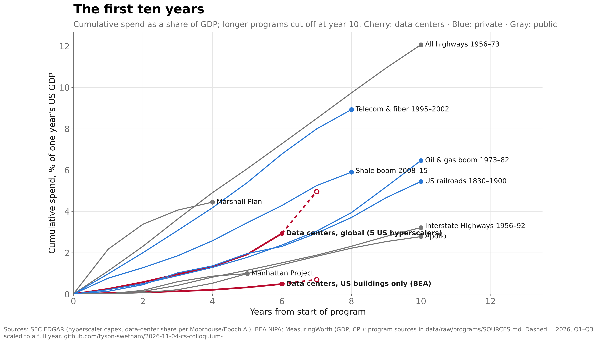
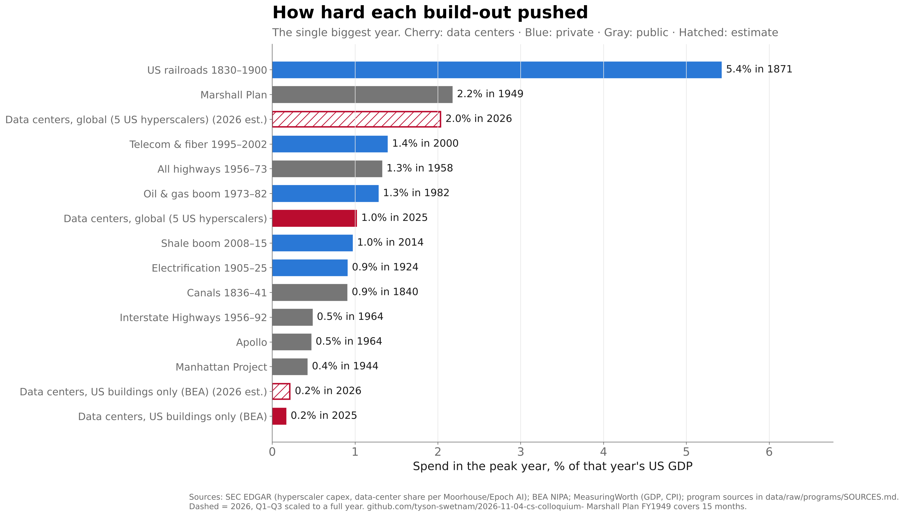
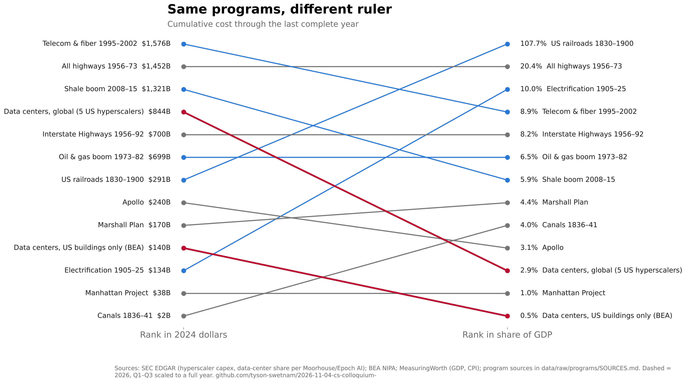
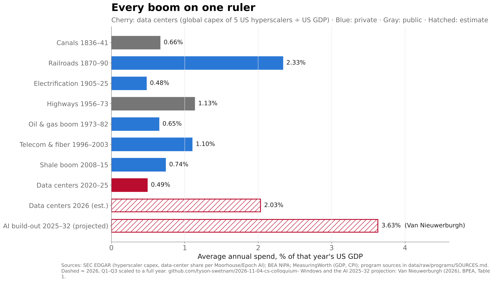

# Slide 05 · The build-out

> **Revised deck.** The revised deck (2026-10-31) drops the "$560B through 2026 · $800B on the 2027 run rate" line, so claims `c2`–`c3` are superseded. The title, footer and notes are unchanged, so `c1`, `c4` and `c5` and their suggested wording still apply.

Section: 01 · Fear · Slide text and notes: [`talk/slides.md`](../../talk/slides.md#slide-05)

> **The largest single investment in human history**
> US data-center build: $560B through 2026 · $800B on the 2027 run rate
> *Notes:* Six years of data-center capex has already outrun 71 years of railroads and 37 years of the Interstates.

The slide follows Fin Moorhouse's chart ["The hyperscalers have already outspent the most famous US megaprojects"](https://x.com/finmoorhouse/status/2044933442236776794) (17 April 2026). It plots cumulative cost in 2024 dollars against years since each program started.

## On the slide

Slide 5 now carries two charts, placed by `src/06_place_in_deck.py` (idempotent; re-run after re-exporting the deck):

| | |
|---|---|
|  **Cumulative cost, 2024 dollars:** Moorhouse's measure, rebuilt from primary sources |  **Every boom on one ruler:** average annual spend as a share of US GDP |

The footer now reads "SEC EDGAR, BEA, MeasuringWorth, FHWA, NASA, Van Nieuwerburgh · After Fin Moorhouse". These are slide-size versions (`deck_fig1.png`, `deck_fig5.png`, made by `04_figures.py`) of [`fig1_baseline_cpi.png`](figures/fig1_baseline_cpi.png) and [`fig5_boom_intensity.png`](figures/fig5_boom_intensity.png). They are drawn at 808 × 500 px, so the type is 21–22 px on the slide, and they leave out the in-image title, subtitle and source line. The headings are slide text, and the footer names the sources. The dollar chart omits the Marshall Plan and the Manhattan Project (both under $200B), whose labels collided at this size. The full fig1 keeps them, with every source line. `figures/deck_dollars.png` and `figures/deck_gdp.png` are an earlier two-panel version, kept for reference.

## Findings

**Moorhouse's chart reproduces in his own units.** Data-center capex for 2020–25 comes to $844B in 2024 dollars from cash capex, or $899B with finance leases, against his ≈$930B. That beats the Interstates ($700B) and the railroads ($291B).

**Measured against the economy that paid for it, the ranking reverses.** The railroads absorbed 108% of one year's GDP over 1830–1900, and the Interstates 8.2%. Data centers so far have absorbed 2.9%, or 5.0% with the 2026 estimate.

| Build-out | Years | 2024 $ (CPI) | Cumulative, % of one year's GDP | Peak year, % of GDP |
|---|---|---:|---:|---:|
| US railroads | 1830–1900 | $291B | 108% | 5.4% (1871) |
| All highways | 1956–73 | $1,452B | 20.4% | 1.3% (1958) |
| Electrification | 1905–25 | $134B | 10.0% | 0.9% (1924) |
| Telecom & fiber | 1995–2002 | $1,576B | 8.9% | 1.4% (2000) |
| Interstate Highways | 1956–92 | $700B | 8.2% | 0.5% (1964) |
| Oil & gas boom | 1973–82 | $700B | 6.5% | 1.3% (1982) |
| Shale boom | 2008–15 | $1,321B | 5.9% | 1.0% (2014) |
| **Data centers, global, incl. 2026 est.** | 2020–26 | $1,465B | **5.0%** | **2.0% (2026)** |
| Marshall Plan | FY1949–52 | $170B | 4.4% | 2.2% (1949) |
| Canals | 1836–41 | $2B | 4.0% | 0.9% (1840) |
| Apollo | FY1960–73 | $241B | 3.1% | 0.5% (1964) |
| **Data centers, global** | 2020–25 | $844B | **2.9%** | **1.0% (2025)** |
| Manhattan Project | 1942–46 | $38B | 1.0% | 0.4% (1944) |
| **Data centers, US buildings only** | 2020–25 | $140B | **0.5%** | **0.2% (2025)** |

Post-war US private investment (1946–60, economy-wide) is in `ranking.csv` at 230% for scale, but it is not a single build-out. The F-35 and the ISS are not reproduced because no annual series could be built (see `comparators.yaml`).

**Peak intensity is the data centers' real distinction.** At an estimated 2.0% of GDP in 2026, this is the most intense year of any private build-out since the 1880s railroads. It is level with the Marshall Plan's first year and below the railroads' peak of 5.4% in 1871.

**"Biggest in history" is a projection.** Van Nieuwerburgh ([BPEA 2026](https://www.brookings.edu/articles/financing-the-ai-buildout/)) projects 3.63% of GDP a year over 2025–32, which is about 1.6× the railroads' 2.24% average. The WSJ headline ("on track to become the biggest economic bet in U.S. history", 23 Sept. 2026) rests on that projection. He calls it "a scenario rather than a forecast", and notes that GPUs wear out in three to six years while rail and fiber lasted decades.

### Suggested slide wording

- **Title:** "On track to be the biggest economic bet in U.S. history"
- **Number line:** "$1.5 trillion since 2020 · 2% of U.S. GDP this year: the most since the railroads"
- **Footer:** "Share of GDP · SEC EDGAR, BEA, MeasuringWorth, Van Nieuwerburgh (Brookings, 2026) · After Fin Moorhouse"
- **Notes:** "In today's dollars, six years of data centers outspent 71 years of railroads. Measured against the economy that paid for them, the railroads were about 37 times bigger. Data centers are the fastest build-out, not yet the biggest."

## Validation

`src/05_validate.py` checks the pipeline against published figures listed in [`benchmarks.yaml`](benchmarks.yaml). All 15 checks pass; the latest run is in [`validation.csv`](data/processed/validation.csv).

| Check | Published | Ours |
|---|---:|---:|
| Telecom 1996–2003 average, % GDP (Van Nieuwerburgh) | 1.10 | 1.10 |
| Telecom peak 2000 | 1.39 | 1.39 |
| Canals 1836–41 | 0.66 | 0.66 |
| Highways 1956–73 | 1.13 | 1.13 |
| Electrification 1905–25 (his includes municipal plant) | 0.50 | 0.48 |
| Railroads 1870–90, Ulmer nominal / Gallman constant-$ | 2.24 | 2.33 / 2.35 |
| Hyperscaler capex 2020–25, $B (his Fig. 1) | 96.8 … 415.8 | within 1% each year |
| Hyperscaler capex 2026, $B | 800.5 (guidance) | 822 (Q1–Q3 scaled) |
| Moorhouse data centers 2020–25, 2024 $B | ≈930 | 899 with finance leases |

Against Moorhouse's other printed values (2024 $), our sources give Manhattan $38B (his $36B), Apollo $241B ($257B), Marshall Plan $170B ($170B) and Interstates $700B ($620B). Our railroad figure is $291B against his $550B, about half. Ours is Ulmer's gross capital spending from 1870, with Fishlow's construction-cost totals spread by miles built before that. His source for railroads is not stated.

## Figures

| | |
|---|---|
|  `fig1`: Moorhouse rebuilt, with his printed values as diamonds |  `fig2`: the speaker-note claim, in share of GDP |
|  `fig2b`: first ten years of every program |  `fig3`: each build-out's biggest year |
|  `fig4`: rank in 2024 $ vs. share of GDP |  `fig5`: Van Nieuwerburgh's Table 1 windows, recomputed |

## Method

Each measure is a function in [`evidence/econ.py`](../../evidence/econ.py); the deciding measure is share of GDP (decision 2026-10-30).

| Measure | Per year *t*, then summed | Answers |
|---|---|---|
| CPI dollars (Moorhouse) | spendₜ × CPI_ref / CPIₜ | What the same goods would cost today |
| GDP-deflator dollars | spendₜ × P_ref / Pₜ | Same, with economy-wide prices |
| **Share of GDP** | spendₜ / GDPₜ | How much of the economy's output it took |
| Economic share | spendₜ / GDPₜ × GDP_2025 | That share, priced at today's economy |
| Per-capita-income value | spendₜ / (GDP/pop)ₜ × (GDP/pop)_2025 | Adjusted for productivity per person |

Scope decisions:
- **Data centers** are shown two ways:
  - *global*: five US hyperscalers' cash capex × Moorhouse's data-center share, 55% in 2020 rising to 80% in 2026;
  - *US-located*: BEA's data-center structures line, which covers buildings only, so it is a floor.
- **Post-war** means US private fixed investment.
- **Oil and gas** covers both the 1973–82 and the 2008–15 booms.
- **2026** is an estimate: BEA's Q1–Q3 average, and company capex for Q1–Q3 scaled by each firm's 2025 seasonality.

Main caveats:
- Fiscal and calendar years are mixed for the public programs.
- Telecom counts every buyer of communications equipment.
- Gallman's railroad data "were not constructed for analysis as annual series" (Rhode 2002).
- Gross investment overstates the AI build-out's lasting capital relative to rail and fiber.

## Reproduce

```bash
make slide-04
```

That runs `src/01_fetch.py` through `src/05_validate.py`. Downloads are skipped when present and logged in `data/raw/**/MANIFEST.yaml`. The hand-assembled program series in `data/raw/programs/` are documented in [`SOURCES.md`](data/raw/programs/SOURCES.md) and rebuilt by `src/programs/rebuild.sh`, which reproduces them byte for byte. The source PDFs and spreadsheets are not committed; their URLs and SHA-256 hashes are in `data/raw/programs/sources/MANIFEST.yaml`.

```
05-the-build-out/
├── claims.yaml        verdicts on the five claims
├── comparators.yaml   every program: years, financing, series, CSV column
├── benchmarks.yaml    published figures checked by 05_validate.py, plus citations
├── src/               01_fetch → 02_build → 03_normalize → 04_figures → 05_validate; programs/
├── data/raw/          downloads + MANIFEST.yaml; programs/ (hand-assembled series)
├── data/processed/    tidy CSVs, ranking.csv, validation.csv
└── figures/           PNG + SVG
```
