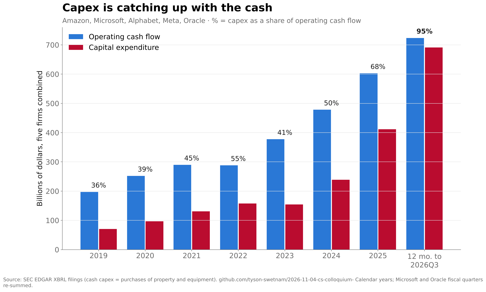
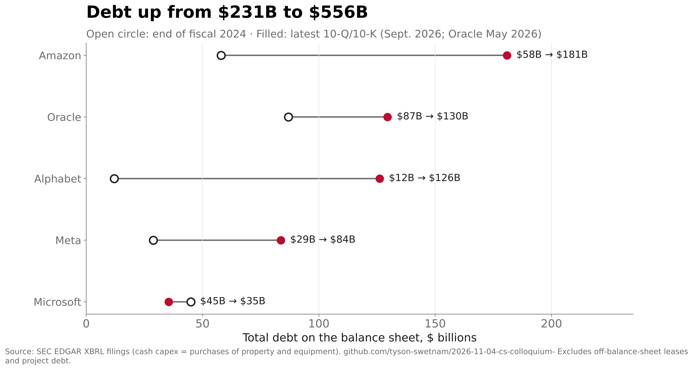
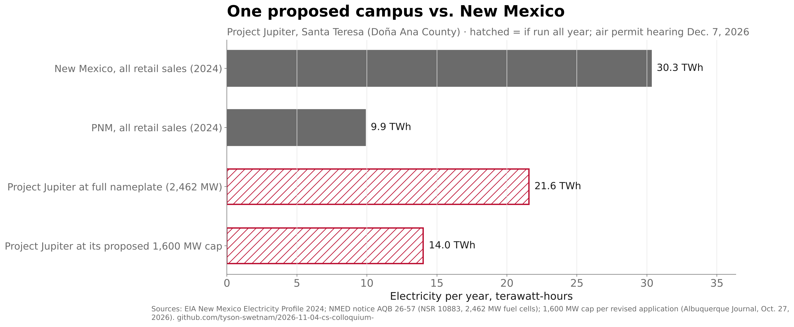

# Slide 05 · The concerns

Section: 01 · Fear · Slide text and notes: [`talk/slides.md`](../../talk/slides.md#slide-05)

> *Notes:* Take each concern seriously; do not dismiss. Each could be its own talk. The point: these deserve answers, not avoidance.

The slide has four bracketed placeholders. Each section below gives candidate one-liners (25 words or fewer), the facts behind them, and caveats. Each fact is a claim in [`claims.yaml`](claims.yaml), with sources and evidence paths.

## 1 · Financial risk: the bubble question, who carries the debt

**Candidate lines**
- *"The five hyperscalers now spend 95¢ of every operating dollar on capex; their debt has more than doubled since 2024, and more sits off the books."*
- *"Capex has caught up with cash: 95% of operating cash flow, up from 50% in 2024. The rest is borrowed, much of it off balance sheet."*

| Fact | Value | Source |
|---|---|---|
| Capex ÷ operating cash flow, five firms, 12 months to 2026Q3 | **95%** (36–55% in 2019–24) | SEC XBRL, computed (`01_financial.py`) |
| Above 100% already | Oracle 161%, Amazon 128% (Microsoft 69%) | same |
| Debt on balance sheets | **$231B → $556B** (FY2024 ends → latest filing) | same |
| Meta's Hyperion campus | ~$30B, ~90% debt, in an off-balance-sheet JV; debt-service coverage 1.12× | Van Nieuwerburgh (2026), §IV |
| Future leases not yet on balance sheets | ~$660B of ~$970B lease commitments | Moody's (2026), via Van Nieuwerburgh |
| Last private capex boom that busted | telecom investment fell 28% from 2000 to 2002 | BEA, via slide 04 |

Our operating cash flow and capex match Van Nieuwerburgh's Figure 1 to within 1% in every year from 2020 to 2025 (`04_validate.py`, [`validation.csv`](data/processed/validation.csv)). The 95% figure uses actual results only; his 2026 figure of 113% includes guidance.




## 2 · Environmental cost: power, water, siting, New Mexico

**Candidate lines**
- *"Data centers used 4.7% of U.S. power in 2024; a proposed Doña Ana County campus wants a 2.5-GW gas plant, above PNM's record peak."*
- *"One proposed campus near Santa Teresa could use up to 46% of New Mexico's electricity; its air-permit hearing opens Dec. 7."*

| Fact | Value | Source |
|---|---|---|
| US data-center electricity, 2024 | 192 TWh, **4.7%** of US use; 9.5–15.3% projected for 2030 | LBNL 2025 Update (primary) |
| …compared with New Mexico | **6.3×** NM's total 2024 retail sales (30.3 TWh) | EIA NM profile, computed (`02_environment.py`) |
| Project Jupiter power plant | **2,462 MW** of gas fuel cells, = **1.09×** PNM's all-time peak (2,264 MW) | NMED notice AQB 26-57 (primary); Albuquerque Journal |
| …at its proposed 1,600 MW cap, run all year | up to 14 TWh, **46%** of NM retail sales | revised application, per Albuquerque Journal; computed |
| Status | air-permit hearing **Dec. 7, 2026**; county "potential breach" vote Oct. 27 | NMED scheduling order (primary) |
| US data-center water, 2023 | ~66B liters on site, ~800B liters through power generation | DOE national-lab slide citing LBNL 2024 (secondary) |
| PNM large-load requests, 2025 | 5,321 MW, 47% of it data centers | PNM 2026 IRP workshop (primary) |

**Caveats**
- **Proposed, not permitted.** Say "proposed", and check the news the day before the talk.
- **The cap is reported, not read.** The 1,600 MW cap comes from news coverage of the revised filing, not the filing itself.
- **Jupiter's water claims conflict.** Oracle says annual use equals nine households; opponents cite 197M gallons used during construction. See [`NOTES.md`](data/raw/environment/NOTES.md).



## 3 · Training and misuse

**Candidate lines**
- *"Courts ruled training on books fair use but pirated copies cost $1.5B; developers report AI-run hacking, and ICML caught 795 rule-breaking LLM reviews."*
- *"Training data is still in court, with a $1.5B settlement over pirated books. Misuse is documented, from AI-orchestrated espionage to LLM-written peer reviews."*

| Fact | Value | Source |
|---|---|---|
| Bartz v. Anthropic (N.D. Cal.) | training "exceedingly transformative… fair use"; pirated library not | Order, Dkt. 231 (June 2025) |
| …settlement | **$1.5B**, ~$3,000 per work; final approval July 20, 2026 | court notice; settlement site |
| Thomson Reuters v. ROSS (3d Cir., Sept. 2026) | a non-generative AI's use of Westlaw headnotes "was not fair" | opinion |
| AI-orchestrated espionage (developer report) | 80–90% of tactical work by an AI agent; ~30 targets | Anthropic, Nov. 2025 |
| ICML 2026 peer review | **795 reviews (~1%)** broke a no-LLM pledge; 497 papers desk-rejected | ICML program chairs |
| Hallucinated citations in court filings | 2,241 decisions in Charlotin's database (Oct. 29, 2026) | database |

The threat-report numbers are the developers' own claims. The ICML count is a lower bound: reviews were caught with hidden prompts in the PDFs and checked by people, not by a text detector. Detector-based estimates, such as Pangram's 21% for ICLR, are in [`facts.csv`](data/raw/training_misuse/facts.csv), but ICLR itself calls detector accuracy "far from perfect."

## 4 · Researchers' work in closed systems

**Candidate lines**
- *"Nearly a quarter of The Pile is research papers; publishers have booked $185M+ licensing research to AI firms. Only 8% of researchers trust them."*
- *"Open science trains closed models: BloombergGPT learned from 42B tokens of open research and never released its weights."*

| Fact | Value | Source |
|---|---|---|
| The Pile, share of full-text papers (PMC, arXiv, PhilPapers) | **23.7%** (27.1% with abstracts and NIH grants) | Gao et al. 2020 Table 1, parsed (`05_corpus_shares.py`) |
| BloombergGPT (weights not released) | **42B** scholarly tokens, 5.9% of training | Wu et al. 2023 Table 2, parsed |
| Publisher AI licensing | Taylor & Francis $75M+ (2024); Wiley >$110M lifetime | Informa and Wiley filings |
| Authors asked? | Cambridge UP: opt-in, 40,000+ authors consulted; T&F authors reported not being told | CUP annual report; The Bookseller |
| Researcher trust | **8%** trust AI firms not to use their research without permission | OUP survey, 2024 |
| PubMed Central licences | 43% CC licences that allow commercial reuse; 26% in neither reuse subset | NCBI E-utilities, computed |
| Federal public access | no-embargo access required by Dec. 31, 2025 (NIH from July 1, 2025) | OSTP Nelson memo; NIH NOT-OD-25-101 |

**For balance (and for section 03):** AlphaFold DB is CC-BY 4.0. Evo 2 released its weights, code and training data. OLMo's training data is open under ODC-BY.

## Reproduce

```bash
make slide-05
```

| Script | What it does |
|---|---|
| `01_financial.py` | SEC filings → capex, cash flow, debt |
| `02_environment.py` | EIA download → New Mexico comparisons |
| `03_figures.py` | the three charts |
| `04_validate.py` | checks against Van Nieuwerburgh |
| `05_corpus_shares.py` | parses The Pile and BloombergGPT tables from arXiv source |

- **Research write-ups.** The research passes for sections 2–4 are in `data/raw/{environment,training_misuse,closed_systems}/`, each with `facts.csv` (verbatim quotes, URLs, dates) and `NOTES.md` (conflicts and blocked sources).
- **Source documents.** These are not committed; their SHA-256 hashes are in each `sources/MANIFEST.yaml`.
- **PubMed Central counts.** `src/research/pmc_counts.sh` re-queries them.
