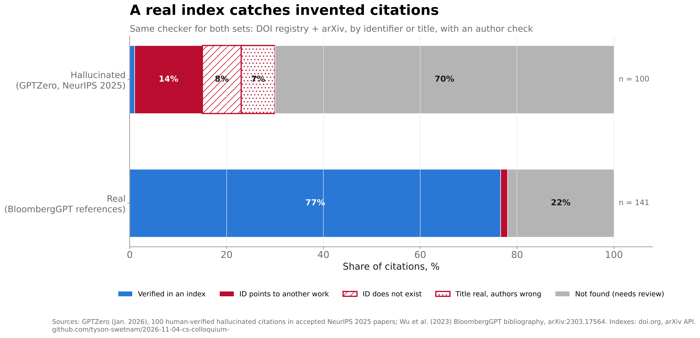

# Slide 06 · Hallucination is an engineering problem

Section: 01 · Fear · Slide text and notes: [`talk/slides.md`](../../talk/slides.md#slide-06)

> *Notes:* Every objection in the first column is real, and every one of them is a missing engineering control, not a property of the model. The four controls (MCP tools, ontology validation, schema-constrained output, provenance) come back in section three.

Each control on the slide is built and run here against real data. The shared pieces live in [`evidence/`](../../evidence/) because sections 03 and 19 reuse them:

| Module | What it does |
|---|---|
| `citations.py` | Citation checker |
| `ontology.py` | OLS4 term validation |
| `http.py` | Cached, rate-polite API access |

## Findings

| Objection → control | Test | Result | Claim |
|---|---|---|---|
| "It invents citations" → call a real index | 100 hallucinated citations from accepted NeurIPS 2025 papers (GPTZero) and 141 real references (BloombergGPT) | **99/100 hallucinated flagged**; **77% of real ones verified automatically**, 22% sent to review, 1.4% false mismatches | ✅ `c1` |
| "It makes up metadata" → terms must resolve in an ontology | Slide 19's seven mappings plus four model-style errors, checked live against OLS4 | all four errors refused; 6 of 7 mappings written; "transcriptome" sent to review | ✅ `c2` |
| "It varies run to run" → a JSON schema | Eight outputs against a draft 2020-12 schema | six malformed outputs refused; **a well-formed record with a fake DOI passed** | 🟧 `c3` |
| "I cannot audit it" → provenance in DuckLake | An agent session logged, then its record overwritten | time travel recovers the original; all three tool calls replay with identical hashes | ✅ `c4` |
| GNoME: "380,000 crystals; labs confirmed under 5%" | The paper's own full text; the critique's metadata from the DOI registry | 381,000 stable; **736 (0.19%) already made in labs, which is not a confirmation rate** | ❌ `c5` |



### What the citation test shows

- **Two indexes are enough to start.** The checker uses only the DOI registry and arXiv.
- **It never confirmed a fabricated identifier.** It catches IDs that point to another paper (14), IDs that don't exist (8), and real titles with invented authors (7).
- **The 70 hallucinations it couldn't place are flagged, not passed.** They go to a person.
- **Real references fail for knowable reasons.** The 33 it couldn't confirm are pre-arXiv classics, technical reports and workshop papers, plus two whose registry metadata changed.
- **More indexes would shrink the review queue.** Crossref, OpenAlex, Semantic Scholar and DBLP would cut the 22%. From this environment they were rate-limited or behind a bot challenge.

### What the schema test shows

The objection is about variation, but a schema only fixes the *form* of an answer. Combine it with the citation and ontology checks to control the *content*. The record that passed the schema used a fake DOI taken from GPTZero's NeurIPS list, and control 1 rejects it. Run-to-run variation in content wasn't measured, because there's no model API in this environment.

### GNoME, the slide's example

> "…the identification of 2.2 million crystal structures, of which 381,000 are newly discovered stable materials." "Of the stable structures, 736 have already been independently experimentally realized." (Merchant et al., *Nature* 2023)

- **736 is not a pass rate.** It counts structures other labs had *already* made. The other 99.8% have not been tried, not failed.
- **The critique is about novelty and usefulness.** Cheetham & Seshadri (*Chem. Mater.* 36, 3490, 2024) found "scant evidence for compounds that fulfill the trifecta of novelty, credibility, and utility."

The example still serves the slide's point ("every output is a hypothesis until it is checked"), worded accurately:

> **Suggested:** *Google DeepMind's GNoME predicted 381,000 new stable crystals; 736 (0.2%) had been made in a lab, and critics found few that were both new and useful.*

## Notes for later slides

- **Slide 19, OBI label.** OBI's preferred label for OBI:0001271 is "transcription profiling by RNA sequencing assay"; "RNA-seq assay" is its alternative label.
- **Slide 19, "transcriptome".** The validator refuses it as a name, so present it as a curator's mapping.
- **Slide 19, hierarchy.** The claim checks out: Mammalia (NCBITaxon:40674) is an ancestor of *Mus musculus*.
- **Slide 14.** DuckLake's time travel and snapshot log, shown here, are the evidence for the lakehouse slide too.

## Reproduce

```bash
make slide-06
```

| Script | What it does |
|---|---|
| `01_citations.py` | Citation checks (about 30 minutes on the first run because of arXiv's 3 s rate limit; then cached) |
| `02_ontology.py` | Ontology write checks against OLS4 |
| `03_schema.py` | JSON Schema checks |
| `04_provenance.py` | DuckLake logging and replay |
| `05_gnome.py` | GNoME figures from the paper's full text |
| `06_figures.py` | The citation chart |

API responses are cached in `data/cache/`, which is not committed. The GPTZero table is saved as [`gptzero_neurips_2025_hallucinations.csv`](data/raw/citations/gptzero_neurips_2025_hallucinations.csv).
